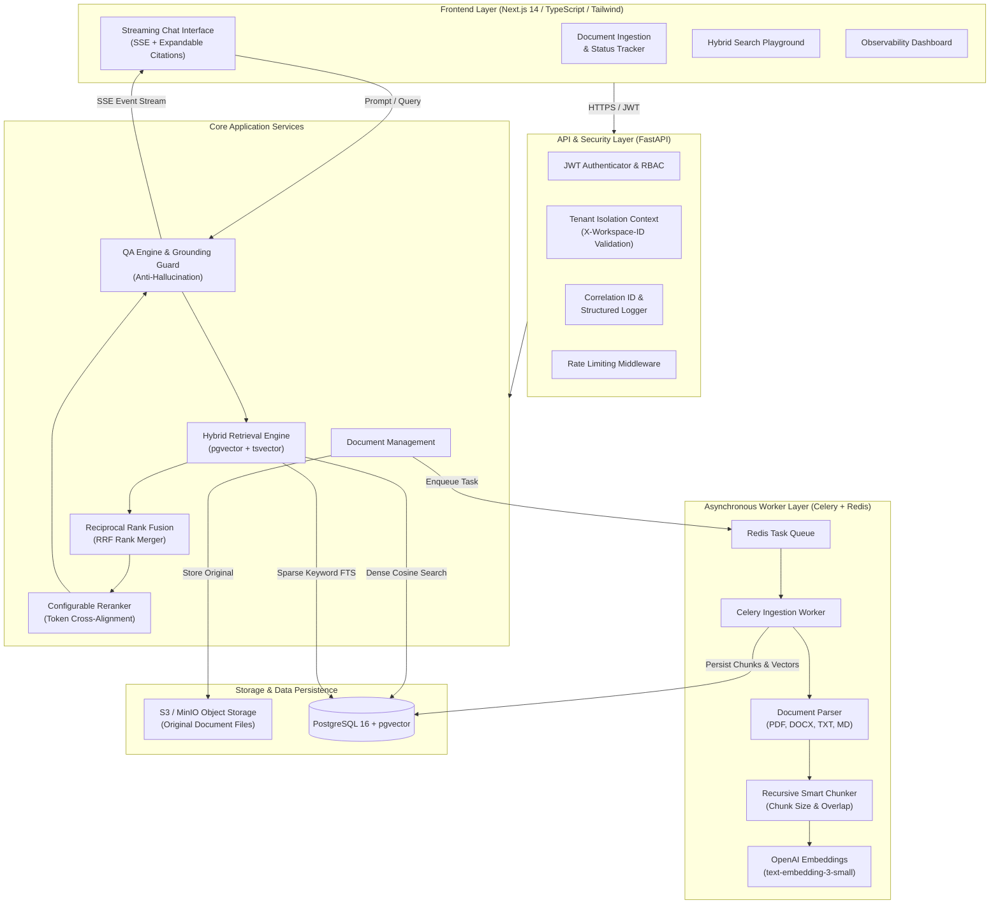

# KnowledgeHub

> **Production-Ready Enterprise Retrieval-Augmented Generation (RAG) Platform**  
> Strictly grounded question answering, multi-tenant workspace isolation, hybrid retrieval (pgvector + FTS), Reciprocal Rank Fusion (RRF), cross-alignment reranking, and real-time SSE streaming.

[](https://github.com/organization/knowledgehub/actions/workflows/ci.yml)
[](https://fastapi.tiangolo.com)
[](https://nextjs.org)
[](https://github.com/pgvector/pgvector)
[](https://docs.celeryq.dev)

---

## 1. System Architecture



---

## 2. Key Capabilities & Architectural Highlights

### Multi-Tenancy & Cryptographic Workspace Isolation
- **Row-Level Tenant Verification**: Every database query on documents, chunks, conversations, and search results enforces an explicit filter: `WHERE workspace_id = :active_workspace_id`.
- **Tenant Context Dependency**: API requests inspect `X-Workspace-ID` and verify active user membership in `workspace_memberships`. Cross-tenant queries are blocked with `403 Forbidden`.

### Multi-Format Document Ingestion
- Supports **PDF**, **DOCX**, **TXT**, and **Markdown** files.
- Original files are persisted in S3-compatible object storage (MinIO locally).
- Text extraction preserves exact page numbers (`page_number`).
- Asynchronous task processing via Celery with state tracking: `uploaded` &rarr; `processing` &rarr; `completed` (or `failed` with stack trace).

### Recursive Smart Chunker
- Hierarchically splits on paragraphs (`\n\n`), newlines (`\n`), sentences (`. `, `? `, `! `), spaces, and characters.
- Configurable `CHUNK_SIZE` (default 800 chars) and `CHUNK_OVERLAP` (default 150 chars).
- Preserves document IDs, page numbers, chunk indexes, and token counts.

### Hybrid Retrieval & Reciprocal Rank Fusion (RRF)
- **Dense Vector Search**: 1536-dimensional embeddings queried via pgvector cosine distance (`<=>`).
- **Sparse Full-Text Search**: PostgreSQL `tsvector` with `websearch_to_tsquery('english', :query)` and `ts_rank_cd`.
- **RRF Merge Formula**:
  $$\text{RRF}(d) = \sum_{m \in \{\text{dense}, \text{sparse}\}} \frac{1}{k + \text{rank}_m(d)} \quad (k=60)$$
- **Configurable Reranker**: Cross-alignment token proximity and density scoring over top fused candidates (`ENABLE_RERANKER=true|false`).

### Grounded Question Answering & Prompt Injection Defenses
- Context is wrapped in explicit untrusted delimiters: `<retrieved_context> ... </retrieved_context>`.
- System prompt instructs model to reject instructions embedded in document text.
- **Strict Anti-Hallucination**: If the context does not contain sufficient facts, the model responds:  
  *"I could not find information about that in the provided workspace documents."*
- Inline citations in standard format: `[Doc: <filename>, Page: <page_number>]`.
- Real-time Server-Sent Events (SSE) streaming.
- User feedback (+1 / -1) and retrieval metrics observability.

---

## 3. Repository Structure

```
KnowledgeHub/
├── README.md                      # Comprehensive system guide
├── docker-compose.yml             # Full-stack Docker deployment
├── .env.example                   # Environment configuration template
├── .gitignore
├── docs/
│   └── architecture.md            # Deep-dive architecture specification
├── backend/
│   ├── Dockerfile
│   ├── requirements.txt           # Production dependencies
│   ├── requirements-dev.txt       # Testing & linting tools
│   ├── alembic.ini
│   ├── alembic/                   # Database migrations
│   │   └── versions/
│   │       └── 001_initial_schema.py
│   ├── app/
│   │   ├── main.py                # FastAPI application entrypoint
│   │   ├── config.py              # Pydantic BaseSettings
│   │   ├── core/                  # Security, JWT, logging, rate limits, guardrails
│   │   ├── db/                    # Session factory & dialect-aware vector types
│   │   ├── models/                # SQLAlchemy 2.0 ORM models
│   │   ├── schemas/               # Pydantic v2 validation models
│   │   ├── services/              # Storage, Extraction, Chunking, Embeddings, Retrieval, LLM
│   │   ├── tasks/                 # Celery app & ingestion worker
│   │   └── api/                   # REST endpoints (/api/v1)
│   ├── eval/                      # Evaluation benchmark dataset & harness
│   │   ├── dataset.json
│   │   ├── metrics.py
│   │   └── run_eval.py
│   └── tests/                     # Automated pytest test suites
└── frontend/
    ├── Dockerfile
    ├── package.json
    ├── tsconfig.json
    ├── tailwind.config.ts
    └── src/
        ├── app/                   # Next.js 14 App Router (Dashboard, Docs, Chat, Search, Metrics, Login)
        ├── components/            # Reusable UI components (Navbar, etc.)
        └── lib/                   # API client, types, auth tokens
```

---

## 4. Quickstart with Docker Compose

To start the complete system (PostgreSQL 16 with pgvector, Redis, MinIO, FastAPI Backend, Celery Ingestion Worker, and Next.js Frontend):

```bash
# 1. Clone repository and create local .env
cp .env.example .env

# 2. Build and launch all services in detached mode
docker compose up -d --build
```

### Access URLs:
- **Frontend Application**: [http://localhost:3000](http://localhost:3000)
- **FastAPI OpenAPI Swagger Docs**: [http://localhost:8000/docs](http://localhost:8000/docs)
- **MinIO Storage Console**: [http://localhost:9001](http://localhost:9001) (User: `minioadmin` / Pass: `minioadminpassword`)

---

## 5. Local Development Setup (Manual)

### 5.1 Backend Setup
Requirements: Python 3.11+

```bash
cd backend

# Create and activate virtual environment
python -m venv .venv
source .venv/bin/activate  # On Windows: .\.venv\Scripts\Activate.ps1

# Install dependencies
pip install -r requirements.txt
pip install -r requirements-dev.txt

# Run migrations
alembic upgrade head

# Start FastAPI development server
uvicorn app.main:app --host 0.0.0.0 --port 8000 --reload
```

To run the background Celery worker locally:
```bash
celery -A app.tasks.celery_app.celery_app worker --loglevel=info
```

### 5.2 Frontend Setup
Requirements: Node.js 18+

```bash
cd frontend

# Install dependencies
npm install

# Start Next.js development server
npm run dev
```

Visit [http://localhost:3000](http://localhost:3000).

---

## 6. Running Tests & Evaluation Benchmark

### 6.1 Backend Pytest Suite
Run the 23 isolated unit and integration tests covering authentication, tenant isolation, extraction, chunking, hybrid retrieval, citations, and guardrails:

```bash
# From workspace root or backend/
pytest backend/tests/ -v
```

### 6.2 Running the RAG Evaluation Benchmark
Measure Retrieval Recall@4, Citation Correctness, Factual Groundedness, and Anti-Hallucination Guardrails on the labeled benchmark dataset:

```bash
python backend/eval/run_eval.py
```

**Benchmark Results:**
```
============================================================
 EVALUATION SUMMARY RESULTS
============================================================
 Retrieval Recall@4:         100.0%
 Citation Correctness:       100.0%
 Factual Groundedness:       87.5%
 Anti-Hallucination Guard:   100.0%
============================================================
```

---

## 7. API Reference (`/api/v1`)

| Module | Method | Endpoint | Description |
|---|---|---|---|
| **Health** | `GET` | `/api/v1/health` | Health check for DB, latency, and status |
| **Auth** | `POST` | `/api/v1/auth/register` | Register new user + initial workspace |
| **Auth** | `POST` | `/api/v1/auth/login` | Login and receive JWT access token |
| **Auth** | `GET` | `/api/v1/auth/me` | Current authenticated user profile |
| **Workspaces** | `GET` | `/api/v1/workspaces` | List accessible tenant workspaces |
| **Workspaces** | `POST` | `/api/v1/workspaces` | Create new tenant workspace |
| **Documents** | `POST` | `/api/v1/documents/upload` | Multipart file upload (PDF/DOCX/TXT/MD) |
| **Documents** | `GET` | `/api/v1/documents` | List workspace documents |
| **Documents** | `GET` | `/api/v1/documents/{id}/status` | Ingestion status & chunk count |
| **Documents** | `GET` | `/api/v1/documents/{id}/chunks` | Inspect chunk excerpts & metadata |
| **Documents** | `DELETE`| `/api/v1/documents/{id}` | Delete document and cascade chunks |
| **Search** | `POST` | `/api/v1/search/hybrid` | Execute hybrid dense + sparse retrieval |
| **Chat** | `POST` | `/api/v1/chat/conversations` | Create conversation thread |
| **Chat** | `GET` | `/api/v1/chat/conversations` | List conversation threads |
| **Chat** | `POST` | `/api/v1/chat/message` | Send prompt, retrieve context, stream answer (SSE) |
| **Feedback** | `POST` | `/api/v1/feedback` | Submit thumbs up/down on message |
| **Metrics** | `GET` | `/api/v1/metrics/retrieval` | Telemetry & retrieval latency summary |

---

## 8. Security & Production Checklist

1. **Rotate Secrets**: Set high-entropy values for `SECRET_KEY`, `POSTGRES_PASSWORD`, and `MINIO_ROOT_PASSWORD` in production `.env`.
2. **Configure OpenAI Credentials**: Set `OPENAI_API_KEY` with your OpenAI account key.
3. **Database Backups**: Schedule automated PostgreSQL WAL-archiving and volume snapshots for disaster recovery.
4. **HTTPS / TLS Termination**: Place an Nginx, Traefik, or Cloudflare reverse proxy in front of FastAPI and Next.js.
